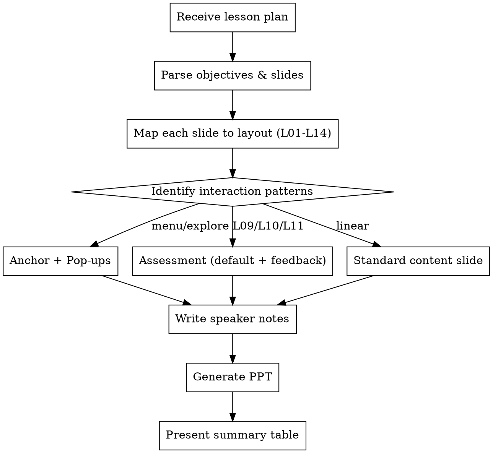

# eLearning Storyboard Generator

## Overview

Transforms a lesson plan (objectives + slide-by-slide outline) into a PowerPoint storyboard where each slide is a wireframe of the learner's screen, with voiceover scripts and developer notes in speaker notes.

## When to Use

- User provides a lesson plan, content outline, or module structure
- User asks to "storyboard" or "create a storyboard for" eLearning content
- User has learning objectives and wants to map them to eLearning screens

## Inputs

A **lesson plan** that combines:
- Learning objectives, audience, assessment strategy
- Slide-by-slide outline with titles, key messages, learning emphasis, interaction types

## Output

A `.pptx` file where each slide is a storyboard card:
- **On-slide:** wireframe visualization of the layout (what the learner sees)
- **Speaker notes:** voiceover script, visual descriptions, interaction & developer notes

## Workflow



### Step 1 — Parse the Lesson Plan

Extract from the input:
- Learning objectives and audience
- Each slide's: number, title, key messages, learning emphasis, interaction type
- Assessment strategy and activity descriptions
- **Identify click-to-explore / menu-hub patterns** — where multiple topics branch from one anchor

### Step 2 — Map Slides to Layouts

Assign a layout ID using the Page Type → Layout Mapping:

| Page Type | Allowed Layouts |
|-----------|-----------------|
| Learning objectives | L13 (Objective) or L05 (3-up cards) |
| Concept explanation | L01 / L03 / L04 |
| Process / how-to | L07 (Stepper) or L08 (Timeline) |
| Compare options | L06 (Compare 2-up) |
| Menu / module select | L12 (Menu) — **likely an anchor slide** |
| MCQ knowledge check | L09 (MCQ) |
| Scenario decision | L10 (Scenario) |
| Drag / match exercise | L11 (Drag/Match) |
| Wrap-up / summary | L14 (Summary) |
| Hero / section intro | L02 (Hero + Body) |

Default to **L01** if layout is unclear. If content doesn't fit one slide, split it.

### Step 3 — Build Storyboard Slides

There are **three interaction patterns**, each requiring different storyboard treatment:

#### Pattern A: Standard Content Slide
One storyboard slide per screen. Wireframe the layout directly.

#### Pattern B: Anchor + Pop-up Slides
When the lesson plan has a menu/hub that branches into multiple topics (e.g., "click each component to explore"):

1. **Anchor slide** — a **vertical bar list** (L12). Full-width horizontal bars stacked vertically (01, 02, 03…), each with a number badge on the left and component name in white text. NOT a 2×4 grid. All tiles unvisited.
2. **One pop-up slide per topic** — each shows the pop-up overlay on top of the anchor. Each pop-up has:
   - The anchor title preserved at top (dimmed/faded)
   - The component bar (number + title) with an **X close button**
   - A **dark content panel with blue border** below the component bar — stays on-theme, not white
   - Content inside uses **dash-style bullets** ("- "), not checkmarks
   - Pop-up layouts are chosen from L01-L08 based on content needs
3. **Anchor with visited states** — shows the anchor after all topics visited, with **✓ checkmarks** on completed tiles. This communicates the visited-state tracking to developers.

**Pop-up layout varies by content complexity:**
- Simple concept → full-width text + dash bullets (like L01 inside the pop-up)
- Concept + visual → dash bullets left + image placeholder right (like L03/L04 inside the pop-up)
- Process/timeline → bullets left + process flow arrows right (like L07 inside)
- Comparison → two-column with section headers inside the pop-up (like L06 inside)
- Checklist/grid → 2×2 or card grid inside the pop-up (like L05 inside)
- **Key message** → yellow accent bar at top or bottom of the pop-up panel for critical takeaways

**Storyboard numbering for anchor + pop-ups:**
- `2.5-2` — anchor (menu grid)
- `2.5-2-01` — pop-up for component 01
- `2.5-2-02` — pop-up for component 02
- `2.5-2-visited` — anchor with checkmarks (final state)

#### Pattern C: Assessment Slides (Default + Feedback)
For L09, L10, L11 — always create **two storyboard slides**:

1. **Default state** — question/interaction as the learner first sees it. No feedback visible. Submit button active.
2. **Feedback state** — left ~2/3 shows the question with learner's selection marked. Right ~1/3 is a feedback panel (green for correct, red for incorrect). Continue button in the feedback panel.

### Step 4 — Write Speaker Notes

Every slide's speaker notes have three sections:

```
VOICEOVER:
[Conversational narration script for this slide]

VISUAL/GRAPHIC DESCRIPTION:
[Detailed description of what the learner sees — images, diagrams, animations, media]

INTERACTION & DEV NOTES:
[Component type, states, branching, build instructions for the developer]
```

**For pop-up slides**, the INTERACTION & DEV NOTES must specify:
- That this is a pop-up layer on the anchor slide
- X close button returns to anchor
- Visited tile gets a ✓ checkmark on return
- Any internal interactions within the pop-up

**For feedback-state slides**, replace INTERACTION & DEV NOTES with:

```
FEEDBACK — CORRECT:
[Feedback text when learner answers correctly]

FEEDBACK — INCORRECT:
[Feedback text when learner answers incorrectly]

DEV NOTES:
[Build instructions for the feedback panel]
```

### Step 5 — Generate and Present

1. Run `storyboard-template.py` to generate the `.pptx`
2. Present a summary table to the user:

| Slide # | Title | Layout | Type | Notes |
|---------|-------|--------|------|-------|
| 2.5-1 | What is a procurement plan | L03 | Standard | — |
| 2.5-2 | Plan structure | L12 | Anchor | 8-tile menu hub |
| 2.5-2-01 | Objectives & Criteria | Pop-up (L01) | Pop-up on 2.5-2 | Text + bullets, X close |
| 2.5-2-02 | Scope & Packaging | Pop-up (L04) | Pop-up on 2.5-2 | Text + media, X close |
| 2.5-2-visited | Plan structure (visited) | L12 | Anchor state | All ✓, Continue active |
| 2.5-3a | Knowledge check | L09 | Assessment default | — |
| 2.5-3b | Knowledge check | L09 | Assessment feedback | Right 1/3 panel |

## Rules

1. **On-slide = wireframe only.** Visualize the layout with shapes and text. No raw placeholder dumps.
2. **Speaker notes = everything else.** VO script, visual descriptions, dev notes.
3. **Use layout IDs.** Every slide must declare its layout (L01-L14).
4. **Respect content limits.** Max 150 words per slide, 7±2 visual elements.
5. **One idea per slide.** If content overflows, split into another slide.
6. **Assessment = two slides.** Default state + feedback state. Always.
7. **Anchor + pop-ups for menu hubs.** Never make pop-up topics into separate standalone slides. They are layers on the anchor.
8. **Pop-up layouts vary.** Choose the right internal layout based on content complexity — don't force all pop-ups into the same template.
9. **Show visited states.** Include an anchor-with-checkmarks slide to communicate visited-state tracking to developers.
10. **X close button on every pop-up.** Top-right of the component bar.
11. **Follow anti-patterns list.** No MCQs with decorative graphics, no video in cards, no stacked interactions, etc.
12. **Use placeholder names** in on-screen text: `{{TITLE}}`, `{{BODY}}`, `{{BULLETS}}`, `{{MEDIA_1}}`, `{{STEM}}`, `{{OPT_A}}`, etc.
13. **Sentence case everywhere.** All text — titles, component bars, bullets, section headers — uses sentence case, not title case.
14. **Content alignment.** Body content, bullets, grids, and all elements start at the SAME left position as the slide title. No indenting body content to the right of the title.
15. **Pop-up = dark panel with blue border.** Pop-ups are a dark content panel with a blue (#1A9AFA) border, staying on-theme with the dark slide. Anchor title is preserved at top (dimmed). Component bar sits above the panel. Content inside uses white/light text. NOT a white background panel.
16. **Anchor = vertical bar list.** The anchor/menu slide uses full-width horizontal bars stacked vertically (01–08), NOT a 2×4 grid of tiles.
17. **Dash bullets in pop-ups.** Pop-up content uses "- " dash-style bullets, not green checkmarks.
18. **Title slide accent bar.** Module number label (e.g., "MODULE 2.5") has a blue vertical accent line on its left edge.
19. **Key message bars.** Use a yellow accent bar for critical takeaways inside pop-ups — placed at top or bottom depending on content flow.

## Reference Files

These files contain the full layout specs, branding, and content mapping best practices:
- `elearning_available_components_and_layouts_3.md` — layouts L01-L14, EY-Parthenon branding, component mapping, anti-patterns
- `content-mapping-best-practices.md` — objective-assessment-content alignment principles

## Common Mistakes

| Mistake | Fix |
|---------|-----|
| Putting VO script on the slide | VO goes in speaker notes only |
| Making pop-up topics into separate slides | They are pop-up layers on the anchor — show them that way |
| Skipping the visited-state anchor slide | Developers need to see checkmark tracking behavior |
| Using the same layout for all pop-ups | Vary the pop-up layout based on content complexity |
| Forgetting the X close button | Every pop-up needs an X close in the top-right |
| Using one slide for assessment | Always two slides: default + feedback |
| Dumping placeholders as text | Visualize the layout as a wireframe |
| Ignoring content limits | Split into multiple slides if over 150 words |
| Making feedback a small text box | Feedback panel = right 1/3 of the screen |
| Using title case | Sentence case everywhere — titles, bullets, component bars, all text |
| Indenting body content right of title | Body and all elements align to the same left position as the title |
| White background pop-up | Pop-up = dark panel with blue border, stays on-theme |
| Using a 2×4 grid for anchor | Anchor uses full-width vertical bars stacked (01–08) |
| Using checkmarks in pop-ups | Pop-up bullets use dashes "- ", not checkmarks |
| Missing key message bar | Use yellow accent bar for critical takeaways in relevant pop-ups |
